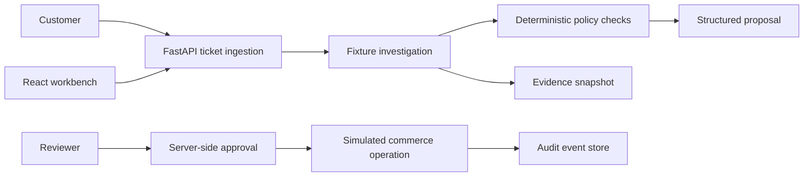
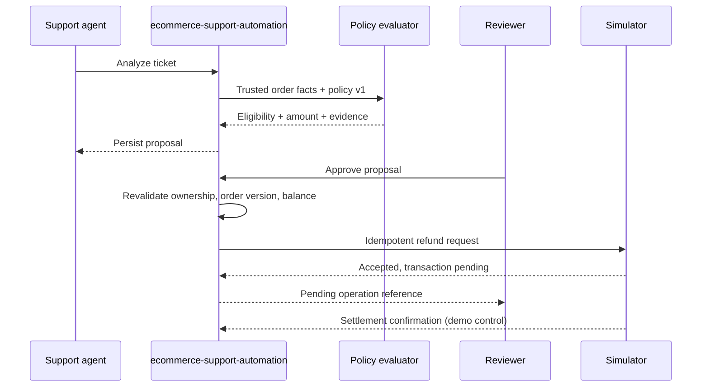

# ecommerce-support-automation

[](LICENSE)

**From support ticket to verified action.** ecommerce-support-automation is a local demonstration of policy-grounded ecommerce support operations. It investigates fictional support tickets, checks deterministic merchant rules, prepares refund proposals for human review, and records simulated refund outcomes.

The project includes a React workbench, a FastAPI service, and a separate HTTP commerce simulator. It does not connect to a real store or move money.

## Architecture

The system coordinates support ticket ingestion, deterministic policy evaluation, human-in-the-loop approvals, and simulated commerce actions across three distinct local services:



### End-to-End Proposal Lifecycle



For detailed component boundaries, data ownership, state transition models, and sequence explanations, see [docs/architecture/README.md](docs/architecture/README.md).

## Features

- Fictional tickets, customers, and orders for guided scenarios
- Deterministic fixture classification and optional OpenAI-compatible classification
- Inspectable investigation evidence and policy decisions
- Refund proposals with reviewer approval and stale-order checks
- A simulator with idempotency, pending and settled states, and fault injection
- Audit history, policy versioning, and an eight-case fixture evaluation suite
- Local development with Docker Compose or the Makefile

## Quick start

Requirements: Python 3.12 or newer, Node.js 22, pnpm 12.3.4, and Make.

```bash
make install
make dev
```

Open [http://localhost:5173](http://localhost:5173). The API and its OpenAPI docs are available at [http://localhost:8000](http://localhost:8000) and [http://localhost:8000/docs](http://localhost:8000/docs). The simulator runs at [http://localhost:8001](http://localhost:8001). Local services bind to loopback.

The demo sign-in has three roles. Use `agent`, `reviewer`, or `admin`; the shared demo password is `demo`. These credentials are intentionally public and must never be used outside the local demo.

To reset both demo databases, stop the services and run:

```bash
make reset
```

Docker Compose is also available:

```bash
docker compose up --build
```

The Compose stack is configured for local demonstration and publishes its ports on loopback. Do not expose it to a network or use it with real customer or payment data.

## Guided workflow

1. Sign in as `agent`, open the eligible refund ticket, and start an investigation.
2. Review the identified order, policy result, evidence, and proposed amount.
3. Sign in as `reviewer` and approve the proposal.
4. Execute the simulated refund and observe its `PENDING` state.
5. Settle the simulated transaction and confirm the updated order balance.
6. Inspect the execution and audit history.

Other scenarios demonstrate missing order information, expired eligibility, final-sale exclusions, prompt-injection text, damaged items, stale proposals, and an uncertain provider response.

## Policy and AI

The sample policy is [`policies/demo-store/returns-v1.yaml`](policies/demo-store/returns-v1.yaml). Deterministic fixture classification is the default and requires no model or API key.

An optional OpenAI-compatible chat-completions provider can be configured for Ollama or a compatible hosted service. Set `AI_PROVIDER`, `AI_BASE_URL`, and `AI_MODEL` in the **API service environment**. Set `AI_API_KEY` there only when the selected provider requires it. The key is not used by the browser. Ticket text is sent to the configured provider when model mode is enabled, so review that provider's data handling before use. Structured output is validated; model output does not authorize refunds or replace deterministic policy checks.

The fixture suite does not benchmark or validate model quality. Run it with:

```bash
make eval
```

The runner prints the eight scenario results and writes JSON and Markdown reports under `evaluations/reports/`. Generated reports are ignored by Git.

## Development

```bash
make test
```

This runs the API and simulator tests and Ruff checks, then the frontend typecheck and production build. CI runs these checks on pushes and pull requests to `main`.

Use `make api`, `make simulator`, and `make web` in separate terminals when starting services individually. `make install`, `make reset`, and `make eval` cover setup, demo data, and scenario evaluation.

## Scope and limitations

This is a local demo, not a production customer-service system. The API and simulator use separate SQLite databases. Demo authentication uses fixed credentials. The API persists an execution job before the explicit execution call, but there is no independent worker. Provider uncertainty is marked for reconciliation, but reconciliation is not automated. There is no tenant isolation, production identity provider, PostgreSQL/Alembic migration path, or live Shopify adapter. Refunds use one currency amount rather than line-level tax, shipping, and discount allocations. The model adapter validates output shape but does not verify that explanations are grounded in evidence.

The simulator represents accepted and settled refunds as separate states. Those states are illustrative and do not guarantee real-world payment settlement, reversibility, compliance, or operational suitability.

## Shopify data model notes

The simulator is not a Shopify API implementation. Shopify refunds can include line items, shipping, and taxes; transaction status distinguishes refund creation from payment settlement; and return requests have a separate lifecycle. See Shopify's [refundCreate reference](https://shopify.dev/docs/api/admin-graphql/2026-01/mutations/refundCreate), [Refund object](https://shopify.dev/docs/api/admin-graphql/latest/objects/Refund), [return management guide](https://shopify.dev/docs/apps/build/orders-fulfillment/returns-apps/build-return-management), and [idempotency guide](https://shopify.dev/docs/api/usage/idempotent-requests).

## Contributing and license

See [CONTRIBUTING.md](CONTRIBUTING.md), the [Code of Conduct](CODE_OF_CONDUCT.md), and the [Security Policy](.github/SECURITY.md). ecommerce-support-automation is distributed under the MIT License; see [LICENSE](LICENSE).
