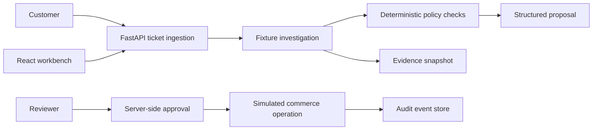
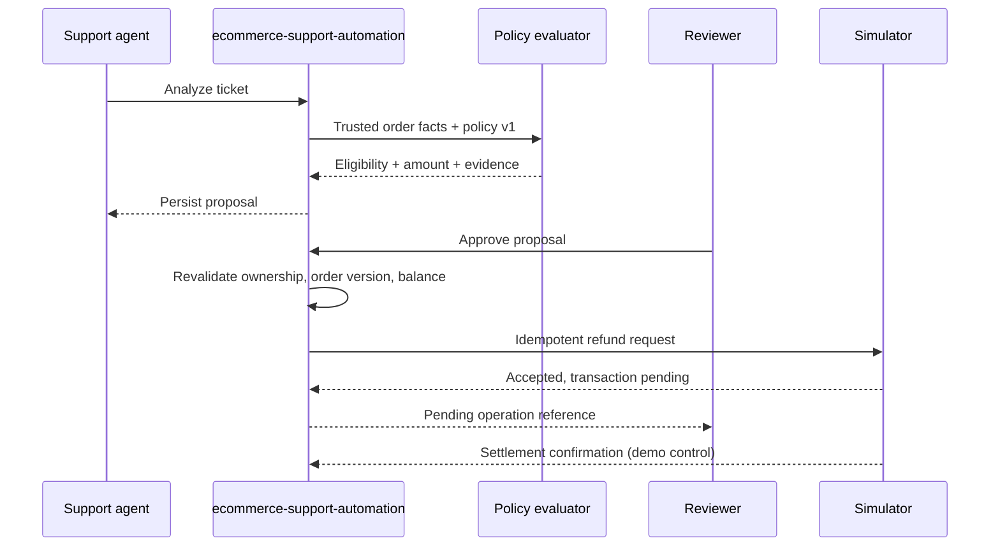

# Architecture

This document outlines the system architecture, component boundaries, and request lifecycles of `ecommerce-support-automation`.

## System Overview

The following diagram illustrates how support tickets flow through ingestion, investigation, deterministic policy evaluation, human review, simulated execution, and audit logging.

### Component Roles & Boundaries

The local stack consists of three distinct processes:
- **React Workbench (Vite / TypeScript):** Provides the role-based UI (`agent`, `reviewer`, `admin`) to investigate tickets, review proposals, and inspect audits.
- **Support Automation API (FastAPI):** Ingests tickets, manages investigation workflows, coordinates with policy evaluation, persists audit logs, and handles proposal approval checks. Maintains a local snapshot of order facts.
- **Commerce Simulator (FastAPI + SQLite):** Serves as an external mock commerce engine with separate storage. Authoritatively owns order balances, enforces idempotent refund execution, handles pending/settled state transitions, and supports fault injection.

Fixture AI is used by default for zero-dependency local runs. An opt-in OpenAI-compatible adapter can call a local or hosted LLM (e.g., Ollama) to extract structured observations from tickets, which are validated before being evaluated against deterministic policy rules.

---

## Investigation & Approval Lifecycle

The sequence below details the interaction between the support agent, core service, policy engine, human reviewer, and simulator during a refund proposal's lifecycle.

### Proposal State Transitions

- **Proposal Lifecycle:** Proposals transition strictly through `PENDING → APPROVED → EXECUTED`. Rejection is terminal.
- **Stale-Order Checks:** Order version and balances are revalidated both upon reviewer approval and immediately prior to execution.
- **Financial Simulation:** Operations reflect an explicit pending state before settlement confirmation to simulate real-world asynchronous payment gateway semantics.

